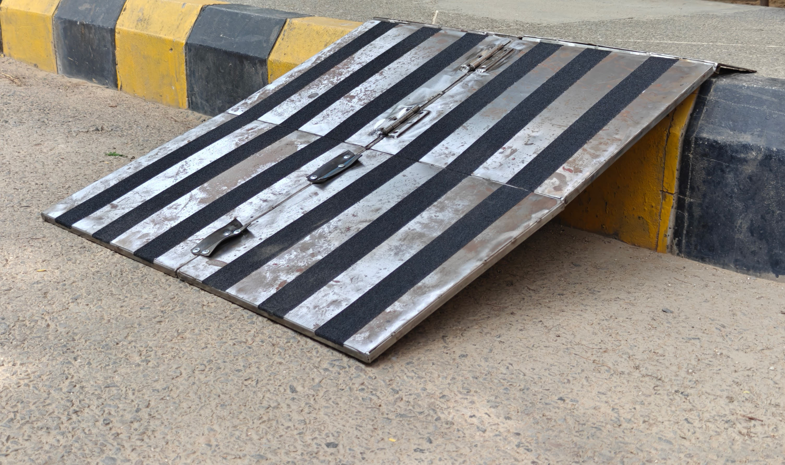
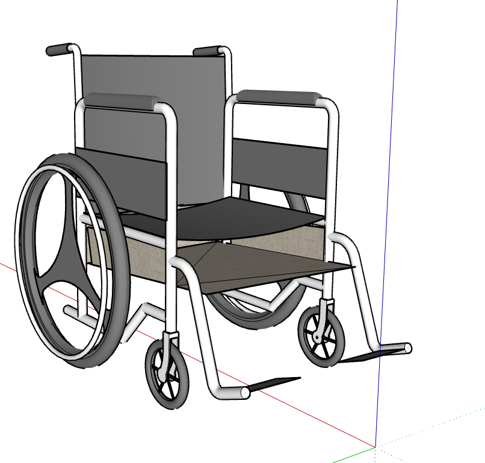
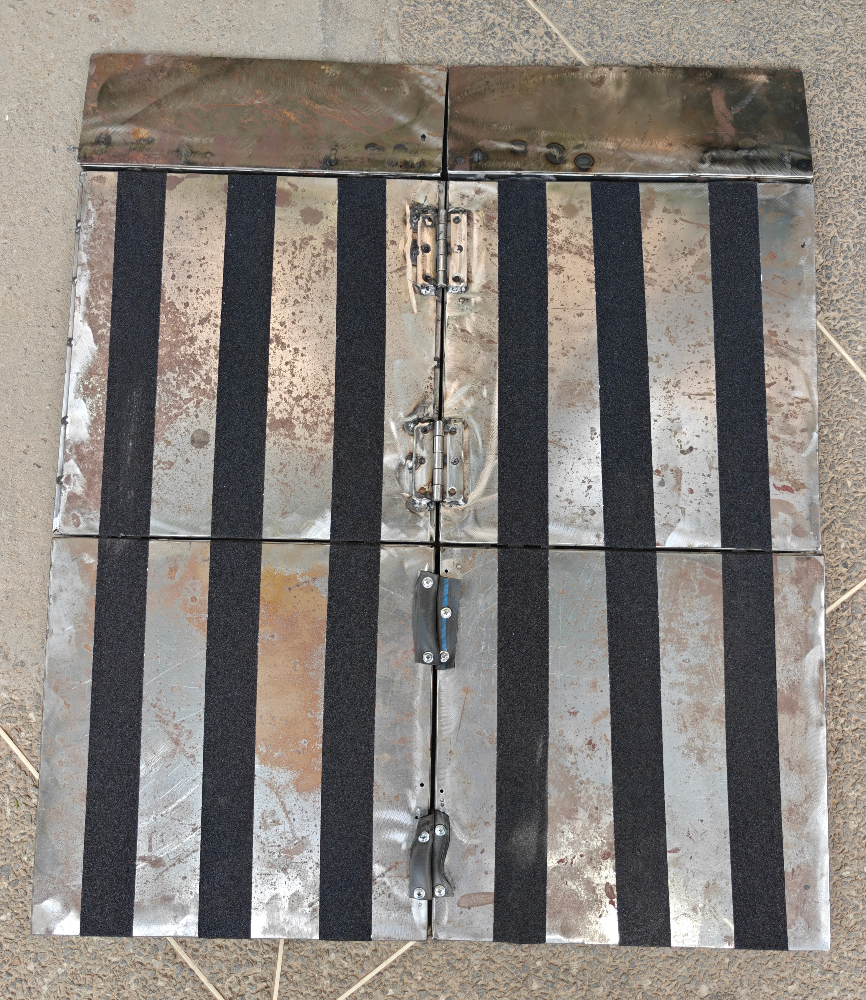
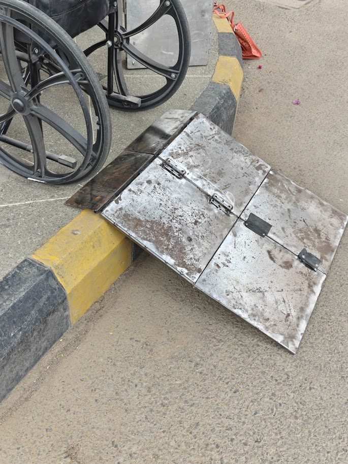
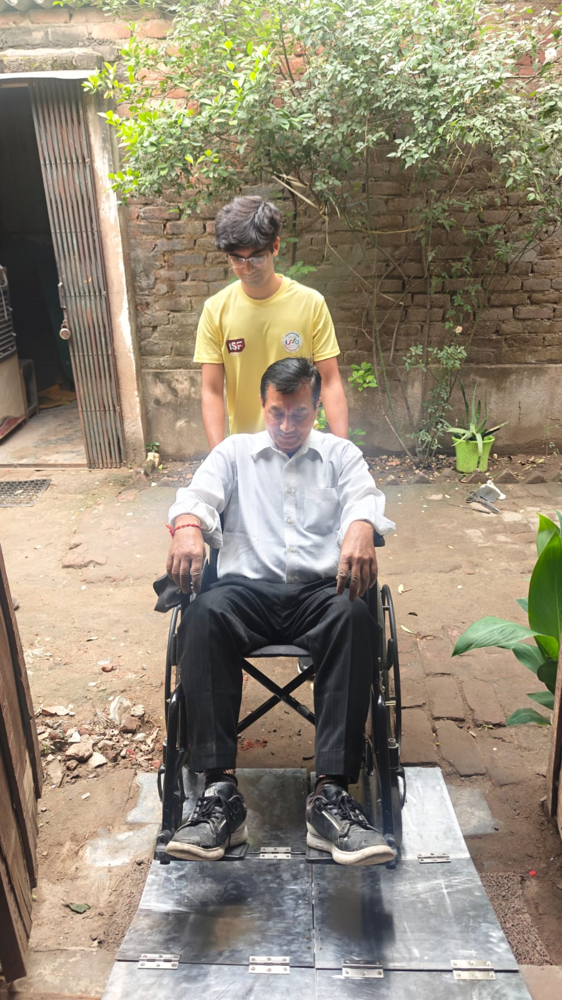

<p align="center">
  <h1 align="center">Ramp-Up</h1>
  <p align="center"><strong>A Compact, Foldable Wheelchair Ramp for Independent Step-Height Accessibility in Built Environments</strong></p>
  <p align="center">
    <a href="https://github.com/SaianshT/Ramp-Up/blob/main/docs/Indian_Design_Patent_506885-001.pdf"></a>
    
  </p>
  <p align="center">
    
    
    
    
  </p>
</p>

<p align="center">
  
</p>

---

## Problem & Accessibility Barriers

Over **70 to 80 million people** worldwide rely on wheelchairs for daily mobility. Despite legal mandates, urban infrastructure in developing nations remains acutely inaccessible:
- **Built-Environment Audits:** Recent municipal accessibility surveys indicate that over **67% of non-residential public buildings** (pharmacies, clinics, restaurants, and retail shops) completely lack entrance ramps.
- **The Step Barrier:** A single curb or architectural step of just **4 to 6 inches** completely arrests wheelchair mobility, stripping users of their autonomy.
- **The Flaw of Existing Solutions:** Commercial portable ramps are heavy (often exceeding 8–12 kg), rigid, or prohibitively long, requiring a dedicated companion or vehicle to transport. As a result, wheelchair users are forced to avoid inaccessible spaces or depend entirely on bystanders for dangerous manual lifting.

---

## Solution Overview

**Ramp-Up** is an ultra-portable, self-contained wheelchair ramp engineered to bridge 1-to-2 step barriers and street curbs without requiring permanent infrastructure or secondary assistance.

Fabricated from lightweight 2.5 mm / 3.0 mm structural aluminum alloy sheets joined by reinforced continuous mechanical hinges and surfaced with high-traction industrial grip tape, Ramp-Up folds down to an ultra-compact **15 &times; 15 inch** footprint. This allows it to stow seamlessly inside a custom pouch suspended directly beneath the wheelchair seat itself, enabling true independent mobility. In under **15 seconds**, the user or companion can unfold the ramp into a stable **35-inch long by 30-inch wide** incline with an integrated angled transition flap for frictionless wheel rollover.

<p align="center">
  &nbsp;
  
</p>
<p align="center"><em>Left: 3D CAD visualization showing under-seat wheelchair storage pouch. Right: Deployed physical structural aluminum ramp with grip tape and transition lip.</em></p>

---

## Mechanical Engineering & Design Specifications

<table align="center" width="100%">
  <thead>
    <tr>
      <th width="30%">Specification Parameter</th>
      <th width="70%">Engineering Implementation Detail</th>
    </tr>
  </thead>
  <tbody>
    <tr>
      <td><strong>Folded Footprint</strong></td>
      <td><strong>15 &times; 15 inches</strong> (Ultra-compact multi-panel bi-fold geometry)</td>
    </tr>
    <tr>
      <td><strong>Unfolded Dimensions</strong></td>
      <td><strong>35.0 inches (Length) &times; 30.0 inches (Width)</strong></td>
    </tr>
    <tr>
      <td><strong>Transition Flap</strong></td>
      <td><strong>5.0-inch angled top-step transition lip</strong> ensuring flush seating on curbs and zero wheel catching</td>
    </tr>
    <tr>
      <td><strong>Total System Weight</strong></td>
      <td><strong>3.2 kg</strong> (Portable enough for single-hand carry or wheelchair under-seat storage)</td>
    </tr>
    <tr>
      <td><strong>Material & Surface</strong></td>
      <td>High-strength 2.5 mm / 3.0 mm structural aluminum sheet metal with welded hinges and anti-slip grip tape</td>
    </tr>
    <tr>
      <td><strong>Deployment Time</strong></td>
      <td><strong>&lt; 15 seconds</strong> (100% tool-free manual flip-and-lock operation)</td>
    </tr>
    <tr>
      <td><strong>Load Rating & Safety</strong></td>
      <td>Engineered and tested for standard manual and motorized wheelchairs + occupant load (&ge; 150 kg)</td>
    </tr>
    <tr>
      <td><strong>Prototype Fabrication Cost</strong></td>
      <td><strong>₹3,000 INR</strong> (Economical localized fabrication vs. imported commercial ramps exceeding ₹25,000)</td>
    </tr>
  </tbody>
</table>

---

## Intellectual Property & Patent

Ramp-Up has been granted a formal **Indian Design Patent** by the Patent Office, Government of India:
- **Design Patent Number:** `506885-001`
- **Classification:** Class 12-05 (Transportation & Hoisting Equipment)
- **Grantee / Inventor:** Saiansh Tapuriah
- **Official Documentation:** Available in [`docs/Indian_Design_Patent_506885-001.pdf`](docs/Indian_Design_Patent_506885-001.pdf)

```text
Government of India — Patent Office
Certificate of Registration of Design No. 506885-001
Title: FOLDABLE PORTABLE WHEELCHAIR RAMP
Date of Registration: 24/06/2026 | Date of Issuance: 06/08/2026
```

---

## Real-World Field Validation & Impact

Ramp-Up was field-tested in live urban environments (residential thresholds, pharmacy steps, and public curbs) with active wheelchair users:

<p align="center">
  &nbsp;
  
</p>
<p align="center"><em>Left: Physical aluminum foldable ramp prototype. Right: Real-world user testing with a wheelchair occupant navigating entrance steps.</em></p>

### User Feedback:
> *"Saiansh sent me this ramp to use. It has been very helpful, allowing me the flexibility to take my wheelchair freely over a few steps. In India, we still do not have proper accessible spaces for wheelchairs, like malls, restaurants, pavements, etc. Earlier, I would avoid places which had a few steps to reach the destination. Now, this portable ramp which I conveniently carry with me has helped me go anywhere and everywhere without stress."*  
> &mdash; **User feedback from an individual who is permanently wheelchair-bound**

---

## Repository Structure

```text
Ramp-Up/
├── cad/
│   ├── BACK.png                           # CAD orthographic back elevation
│   ├── BOTTOM.png                         # CAD undercarriage view
│   ├── FRONT.png                          # CAD front elevation
│   ├── LEFT.png                           # CAD side profile
│   ├── PERSPECTIVE LEFT.png               # CAD isometric left
│   ├── PERSPECTIVE RIGHT.png              # CAD isometric right
│   ├── RIGHT.png                          # CAD right profile
│   └── TOP.png                            # CAD plan view showing panel layout
├── docs/
│   └── Indian_Design_Patent_506885-001.pdf # Official granted Indian Design Patent certificate
├── images/
│   ├── ramp_perspective_real.jpg          # Hero photo: real aluminum ramp with grip tape
│   ├── ramp_top_real.jpg                  # Real ramp top view showing panels & transition lip
│   ├── ramp_front_real.jpg                # Real ramp front elevation
│   ├── ramp_perspective_left_real.jpg     # Real ramp perspective left
│   ├── physical_prototype.jpg             # Physical aluminum prototype photo
│   ├── field_curb_deployment.jpg          # Real photo: live wheelchair navigation user testing
│   └── wheelchair_pouch_integration.png   # 3D render of under-seat pouch deployment
└── README.md
```

---

## Author, Intellectual Property & Acknowledgements

- **Inventor & Lead Designer:** Saiansh Tapuriah
- **Intellectual Property Citation:**
  > **Tapuriah, S. (2024).** *Wheelchair Ramp*. Indian Design Patent No. `506885-001`, The Patent Office, Government of India. Class 12-05 (Assistive mobility and patient transport equipment). Certified and granted under the Designs Act, 2000.
- **Accessibility & Engineering Design Standards Referenced:**
  1. **ADA Standards for Accessible Design (2010):** U.S. Department of Justice, Section 405 (*Ramps: Slope, Cross Slope, Surface Characteristics, and Edge Protection*).
  2. **Harmonised Guidelines and Space Standards for Barrier-Free Built Environment for Persons with Disabilities and Elderly Persons (2021):** Ministry of Housing and Urban Affairs (MoHUA), Government of India (Specifications for threshold ramps, curb cuts, and portable accessibility ramps).
  3. **ASTM B209 / B221:** Standard Specification for Aluminum and Aluminum-Alloy 6061-T6 Sheet and Plate (Structural yield strength: 276 MPa; ultimate tensile strength: 310 MPa; strength-to-weight optimization).
- **User Validation & Field Testing Credit:** Sincere gratitude to the wheelchair-bound community participant who conducted iterative live usability testing, negotiating real-world architectural barriers and curbs to validate mechanical stability and deployment velocity.
- **Institutional Recognition:** Recipient of **The Shri Ram School's Innovator Award**.
